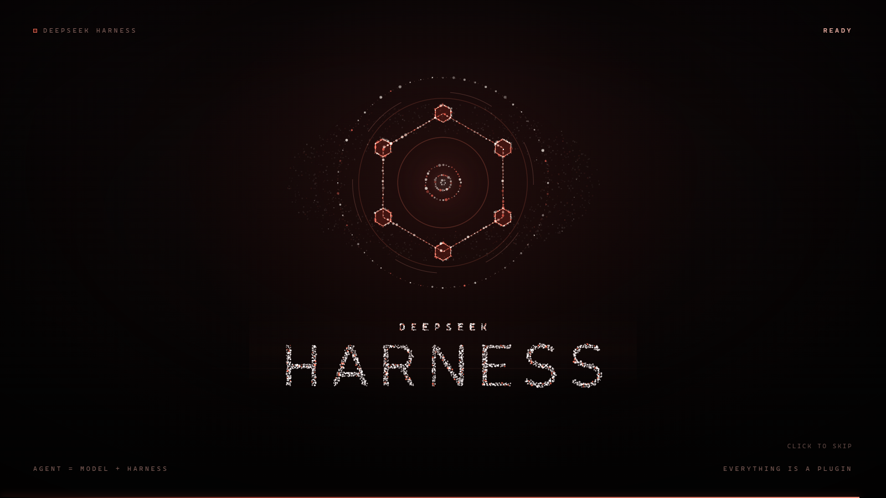
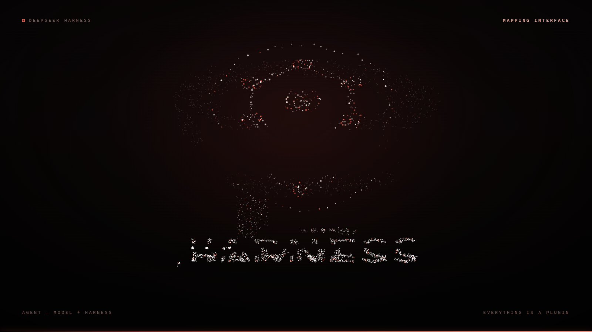
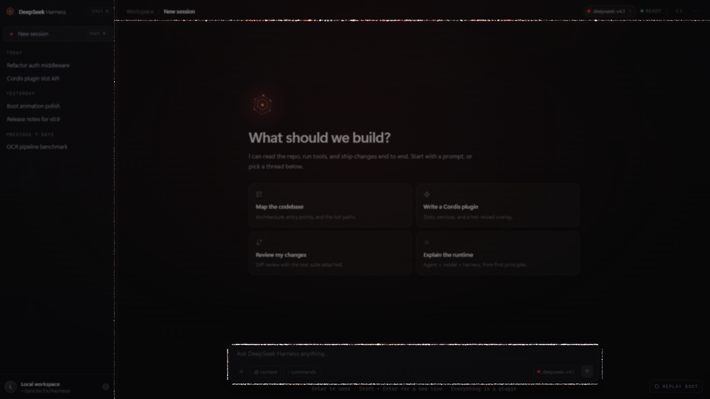

# DSH 粒子启动动画

为 **DeepSeek Harness 桌面端**做的开屏动效插件：粒子汇成六边形徽记，再组成 **HARNESS**，最后全部飞向真实界面的边线——侧栏分隔线、顶栏横线、输入框轮廓——遮罩同时淡出，工作台就在粒子停下的位置平整显影。动效跑完自己移除，不改动应用的任何其它部分。





## 它解决的两个坑

桌面端插件不是「放进目录就会加载」，而且宿主半跑在 Node 进程里，没有 `document`：

1. **必须有挂载条目**。`%USERPROFILE%\.dsh\profiles\desktop\cordis.patch.yml` 里要有对应的 `- insert:`，否则启动时根本不会加载。
2. **形态要分两层**。宿主半（Node）只负责在 `webserver/index-inject` 时向页面注入 `style / 标记 / 引擎源码 / 启动脚本`；真正的动画在页面里跑，结束时自毁并发 `hsx:done`。

这个插件就是按这个契约写的，`install.mjs` 会帮你把两层都放到位。

## 安装

```powershell
git clone https://github.com/hbgdjb/dsh-boot-particles.git
cd dsh-boot-particles

node install.mjs --dry-run     # 先看计划，不写盘
node install.mjs               # 正式安装
```

然后**完全退出 DeepSeek Harness（连托盘图标一起退出）再重新打开**。宿主插件是进程内模块，只刷新页面不会重新加载。

安装器只碰两个位置：

| 位置 | 动作 |
| --- | --- |
| `%USERPROFILE%\.dsh\plugins\dsh-boot-particles\` | 复制 `dsh/lib/` 与 `dsh/package.json` |
| `%USERPROFILE%\.dsh\profiles\desktop\cordis.patch.yml` | 追加一段带 `BEGIN/END` 标记的 `- insert:` 条目 |

首次改 patch 前会备份为 `cordis.patch.yml.bak-boot-particles`；重复运行只刷新文件，patch 只写一次。

### 要求

- 桌面版 DeepSeek Harness（`desktop` profile）。
- 渲染层是 Chromium，支持 `OffscreenCanvas`；不支持时自动退回主线程绘制，观感一致。

### 对 CSP 的依赖

插件执行自己的代码用了两条路径，宿主的内容安全策略必须放行：

| 路径 | 需要的策略 |
| --- | --- |
| Worker（默认） | `worker-src blob:` —— 引擎以 Blob URL 交给 Worker |
| 主线程兜底（Worker 不可用时） | `script-src 'unsafe-eval'` —— 用 `new Function` 执行引擎源码 |

桌面版当前两者都放行，所以直接可用。**如果将来宿主收紧 CSP，插件不会报错，而是静默降级成「只淡出」**——排查时先在 DevTools 里看有没有 CSP 违规日志，别怀疑动画代码。

注入层还有一条自检：引擎源码或启动脚本里只要出现 `</script`，本次注入会被整层跳过并记一条 `warn` 日志（不会把宿主页面截断，也不会留下半块遮罩）。

## 验证

1. `cordis.patch.yml` 里有标记段：

```powershell
Select-String -Path "$env:USERPROFILE\.dsh\profiles\desktop\cordis.patch.yml" -Pattern 'dsh-boot-particles'
```

2. 重启后打开工作台，第一屏就是粒子动画；约 9.3 秒后自动交还界面，无残留遮罩、无白屏闪断。
3. 想再看一次：插件默认一个会话只播一次。重新完全启动即可，或在页面地址后加 `?boot=force`。

## 测试

```powershell
node --test tests/
```

`tests/engine.test.mjs` 用桩 canvas 在 Node 里跑绘制核心：不需要浏览器，也不需要 DOM。测的是时间轴常量自洽、`draw()` 覆盖全时间轴不抛、同一种子可复现、`setTargets` / `resize` 边界，以及「界面还没挂载」时也能跑完。

`tests/packaging.test.mjs` 守几条运行时不报错但会在用户机器上出事的规矩：注入资产里不得出现 `</script`（否则开屏层会被整层跳过）、`dsh/package.json` 的 `main` 必须存在、两处版本号一致、`install.mjs` 的 BEGIN/END 标记成对、README 与 demo 引用的文件都在、不留占位符。

## 卸载

```powershell
node install.mjs --remove      # 只删 patch 段，文件保留
```

彻底卸载再删掉目录 `%USERPROFILE%\.dsh\plugins\dsh-boot-particles`。整份回滚 patch：用 `cordis.patch.yml.bak-boot-particles` 覆盖。

## 结尾是怎么接上的

这是整个动效的重点，也是它不像「炸开消散」的原因。

1. **量边线**。外壳脚本在动画前 6.9 秒里反复读真实界面：`[data-dockkit-divider]`（分栏缝）、顶部横跨全宽的 chrome 条、包住输入框的那层带边框的盒子，换算成若干条屏幕坐标线段。界面还没挂载时退回一套经验布局（侧栏 20%、顶栏 6.5%、底部居中输入框），挂载后再覆盖。
2. **分配目标**。每条线段按长度分到相应的粒子配额，每颗粒子挑「最近且还有名额」的线段，线段内再按投影顺序排队。所以粒子是各自就近贴上去，既不交叉成网，也不四散。
3. **显影**。边线形成后不再开径向孔洞，而是把遮罩整体淡出，同时沿量到的边线描一层细光。真实界面在粒子落点处显影，0.8 秒后光带与粒子一起淡掉。

边线探测在 `T_MORPH - 0.18s` 截止，避免飞行途中改目标导致跳变。

## 性能

画质不降，卡顿靠「换线程」解决：

- 画布通过 `OffscreenCanvas` 交给 Worker 绘制，动画节奏不再受宿主主线程影响。开屏时应用自己加载再忙，粒子也照常 60fps 走完。
- 不支持（或被 CSP 拦下）时自动退回主线程绘制，观感一致，只是重新与宿主共享主线程。
- 逐帧不再新建颜色字符串、渐变对象和临时数组（缓存样式 + 预渲染贴图 + 复用坐标）。
- 字标采样只读文字包围盒，启动瞬间不再一次性读回 8MB 画布。
- HUD、进度条、遮罩的 DOM 写入按 30Hz 限频，不参与每帧绘制。
- 边线探测只做 `getBoundingClientRect`，每次不到 2ms，并且只把坐标发给 Worker，不搬动任何 DOM。

作者机器（Windows / 2K / 165Hz）实测 10 秒窗口内主线程 `ScriptDuration`：改造前约 4650ms，改造后约 19ms，总 `TaskDuration` 从约 5548ms 降到约 390ms。

## 目录结构

| 文件 | 作用 |
| --- | --- |
| `install.mjs` | 安装 / `--dry-run` / `--remove` |
| `dsh/lib/index.js` | 宿主半：读资源，向 `webserver/index-inject` 推 style / 标记 / 引擎源码 / 启动脚本 |
| `dsh/lib/overlay.js` | 外壳：建 DOM、走时间轴、量界面边线、管 Worker 与本地绘制 |
| `dsh/lib/engine-core.js` | 绘制核心（零 DOM 依赖）：几何、粒子、字标、光效、边线吸附 |
| `dsh/lib/boot.css` | 首帧保护色，避免应用在引擎加载前闪一下 |
| `dsh/package.json` | 插件清单 |
| `demo/index.html` | 浏览器里预览同一套动画 + 假工作台 |
| `tests/` | `node --test tests/`：绘制核心（桩 canvas）+ 包结构不变量 |
| `docs/` | 预览图 |

## 调参

在 patch 的 `config` 下：

```yaml
config:
  enabled: true
  overlay: true
  playOncePerSession: true   # 改成 false 则每次页面加载都播
```

时间轴在 `dsh/lib/overlay.js` 顶部：

| 常量 | 含义 |
| --- | --- |
| `T_LOCK` | 字标锁定（6.9s） |
| `T_MORPH` | 开始飞向界面边线（7.12s） |
| `T_FORM` | 边线形成、遮罩开始淡出（8.12s） |
| `T_REVEAL` | 光带开始淡出（8.3s） |
| `T_END` | 结束（9.25s） |

粒子数量、配色、拖尾等参数在 `engine-core.js` 的 `create()` 里。超过 15 秒仍未结束会由内置兜底强制移除，不会把界面锁死。

## English

A boot transition layer for the **DeepSeek Harness** desktop shell. Particles form a hex emblem, then the wordmark **HARNESS**, then every particle flies onto the real interface edges — the sidebar seam, the header rule, the composer outline — while the backdrop cross-fades. The workspace appears exactly where the particles stopped, and the layer removes itself afterwards.

```powershell
node install.mjs --dry-run
node install.mjs
```

Fully quit the app (tray icon too) and start it again. Tested on Windows; the renderer needs `OffscreenCanvas`, otherwise drawing falls back to the main thread with identical visuals.

- Host half (`dsh/lib/index.js`) only injects rows into `webserver/index-inject`; it never touches `document`.
- The canvas is owned by a Worker, so the app's own startup work cannot stall the animation.
- Edge probing is read-only (`getBoundingClientRect`) and stops before the morph starts.

`node install.mjs --remove` unwires the patch block; delete `%USERPROFILE%\.dsh\plugins\dsh-boot-particles` to finish.

## License

MIT — see [LICENSE](LICENSE).
